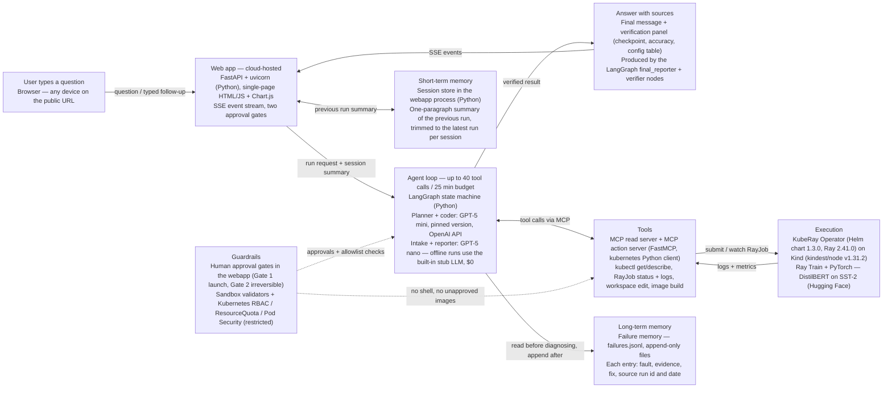

# Design Slide — How a Question Becomes an Answer

One flowchart, per the professor's design-slide specification (Week 5,
slide 19): user → cloud web app → agent loop → answer with sources, with
tools, short-term memory, long-term memory, and guardrails as side boxes.
**Every box is labelled with the model, library, or service behind it** —
an unlabelled box counts as a missing item.

## How to read it (speaker notes for the slide)

- The main flow is one sentence: a typed question enters the cloud web
  app, the LangGraph agent loop plans, calls MCP tools against a KubeRay
  cluster, and the answer comes back with its verification evidence —
  never as an unverified claim.
- Short-term memory is what makes follow-ups work: "same settings, but
  epochs = 3" is understood because the session store carries the
  previous run's summary into the next run.
- Long-term memory is the failure memory: every diagnosis is appended
  with the run it came from and its date, and the critic checks it before
  diagnosing — but still needs fresh log evidence before reusing a fix.
- Guardrails are a side box on purpose: the approval gates and the
  sandbox validators constrain the loop from outside it, so a compromised
  or confused agent cannot approve its own irreversible actions.
